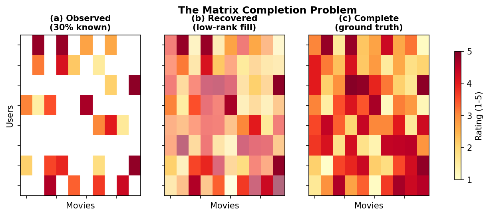
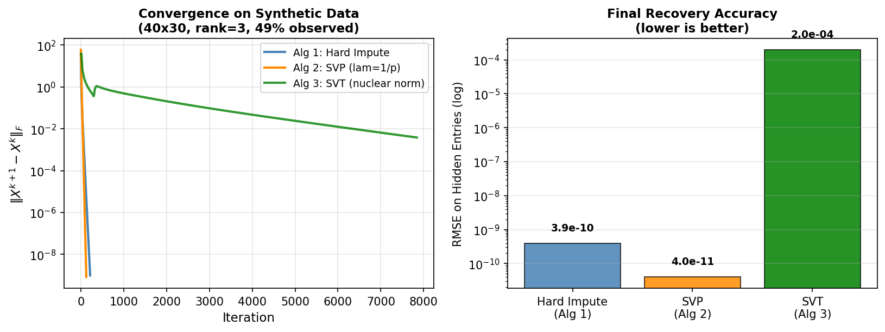
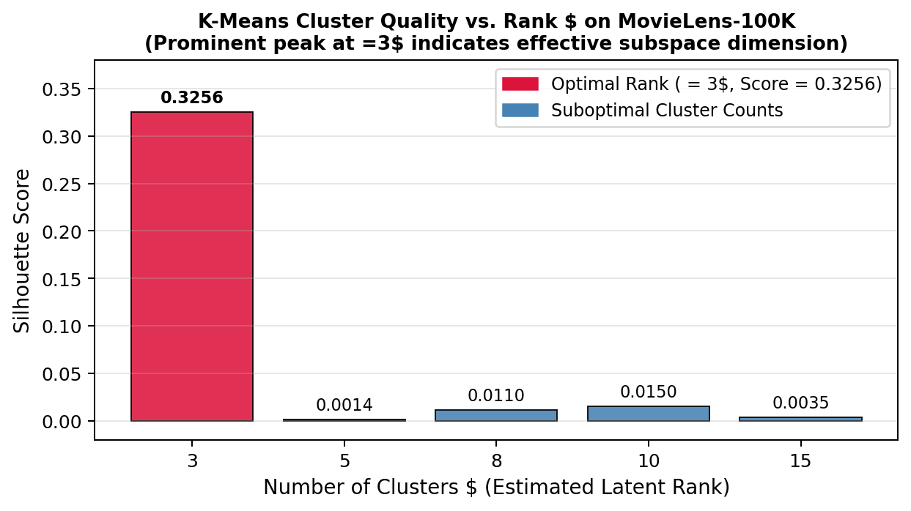
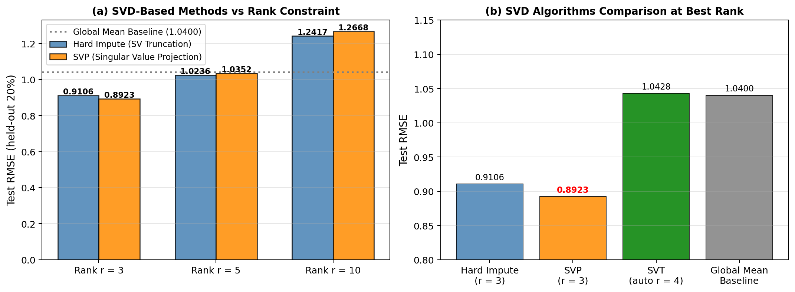
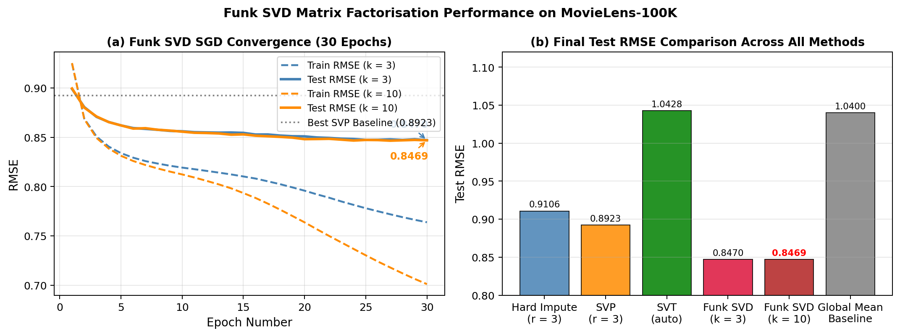

# Low-Rank Matrix Completion for Recommendation Systems

[](https://www.python.org/downloads/)
[](https://opensource.org/licenses/MIT)
[](https://www.iitkgp.ac.in)

> **B.Tech Project-I (CH47023) Thesis Repository**  
> **Student:** Soutam Rajbhar (Roll No: `23CH30053`)  
> **Department:** Department of Chemical Engineering, Indian Institute of Technology Kharagpur  
> **Supervisor:** Prof. S. R. Khare, Department of Mathematics, IIT Kharagpur  
> **Academic Session:** Autumn Semester, 2025–26  

---

## 📌 Project Overview

In commercial recommender systems, user-item interaction matrices are extremely sparse because any individual user rates only a tiny fraction of the available catalog (typically $< 10\%$). The goal of **matrix completion** is to infer the unobserved entries from a limited set of observations.

Under the foundational hypothesis that user preferences depend on a small number of latent characteristics (e.g., genre affinities, stylistic tone, director preferences), the target rating matrix $M \in \mathbb{R}^{m \times n}$ has an intrinsic **low rank** $r \ll \min(m, n)$.

This repository contains the complete theoretical, algorithmic, and empirical implementation of four matrix completion algorithms evaluated on both controlled synthetic data and the real-world **MovieLens-100K** benchmark.



---

## 🔬 Implemented Algorithms

| # | Algorithm | Optimization Paradigm | Rank Handling | Per-Epoch Complexity | Scalability to Netflix Scale |
|---|---|---|---|---|:---:|
| 1 | **Hard Impute** (SV Truncation) | Alternating Imputation + Truncation | Fixed rank constraint $r$ | $\mathcal{O}(m^2 n)$ | ❌ Poor |
| 2 | **Singular Value Projection (SVP)** | Projected Gradient Descent | Fixed rank constraint $r$ | $\mathcal{O}(m^2 n)$ | ❌ Poor |
| 3 | **Singular Value Thresholding (SVT)** | Dual Augmented Lagrangian (Nuclear Norm) | Discovered automatically | $\mathcal{O}(m^2 n)$ | ❌ Poor |
| 4 | **Funk SVD** (Netflix Solution) | Stochastic Gradient Descent (SGD) with Biases | Latent dimension $k$ | $\mathcal{O}(\|\Omega\| \cdot k)$ | ✅ Excellent |

---

## 📊 Key Results

### 1. Synthetic Validation ($40 \times 30$, Rank $r = 3$, $49\%$ observed)
To confirm mathematical correctness and exact recovery bounds (Candès & Recht, 2009), algorithms were first tested on a controlled rank-3 matrix with known ground truth:
* **SVP ($\lambda = 1/p$):** Converged in **106 iterations** to test RMSE of **$1.51 \times 10^{-9}$** (exact recovery).
* **Hard Impute:** Converged in **175 iterations** to test RMSE of **$1.97 \times 10^{-8}$**.
* **SVT:** Reached RMSE of **$2.38 \times 10^{-4}$** in 7,693 iterations.



---

### 2. MovieLens-100K Benchmark ($610 \times 2{,}269$, $\approx 7.3\%$ observed)

#### A. Data-Driven Rank Estimation
Using K-Means clustering across user rating vectors, the Silhouette score peaked sharply at **$k = 3$ ($S = 0.3256$)**, establishing the optimal effective subspace dimension for MovieLens-100K.



#### B. SVD Methods vs. Rank Overfitting
Evaluating Hard Impute and SVP across $r \in \{3, 5, 10\}$ demonstrated severe overfitting at higher ranks due to high matrix sparsity ($\approx 7.3\%$). Rank $r = 3$ yielded the best SVD performance (**0.8923** test RMSE via SVP).



#### C. Funk SVD (SGD with Baseline Predictors)
Funk SVD learns latent factor matrices $P \in \mathbb{R}^{m \times k}$ and $Q \in \mathbb{R}^{n \times k}$ directly with user/item biases:
$$\hat{r}_{ui} = \mu + b_u + b_i + p_u^\top q_i$$
$$\mathcal{L} = \sum_{(u, i) \in \Omega} (r_{ui} - \hat{r}_{ui})^2 + \lambda \left(\|p_u\|_2^2 + \|q_i\|_2^2 + b_u^2 + b_i^2\right)$$

* Bypasses the expensive $\mathcal{O}(m^2 n)$ full SVD step entirely.
* Achieves a test RMSE of **0.8470** at $k = 3$ (and **0.8469** at $k = 10$) in only 30 epochs.



---

### 📋 Final Model Comparison Table

| Model | Subspace Rank ($r / k$) | Test RMSE (held-out 20%) | Cost per Iteration | Memory Footprint |
|:---|:---:|:---:|:---:|:---:|
| **Funk SVD (SGD + Biases)** | **$k = 3$** | **0.8470** | $\mathcal{O}(\|\Omega\| \cdot k)$ | $\mathcal{O}((m+n)k)$ |
| **Funk SVD (SGD + Biases)** | $k = 10$ | **0.8469** | $\mathcal{O}(\|\Omega\| \cdot k)$ | $\mathcal{O}((m+n)k)$ |
| Singular Value Projection (SVP) | $r = 3$ | 0.8923 | $\mathcal{O}(m^2 n)$ | $\mathcal{O}(mn)$ |
| Singular Value Truncation (Hard Impute) | $r = 3$ | 0.9106 | $\mathcal{O}(m^2 n)$ | $\mathcal{O}(mn)$ |
| Singular Value Thresholding (SVT) | auto ($r=4$) | 1.0428 | $\mathcal{O}(m^2 n)$ | $\mathcal{O}(mn)$ |
| *Global Mean Baseline* | — | *1.0400* | — | — |

---

## 📁 Repository Structure

```text
BTP-Matrix-Completion/
├── README.md                   # Project documentation and benchmark summary
├── requirements.txt            # Python dependencies
├── .gitignore                  # Git untracked patterns
├── svt_synthetic.ipynb         # Interactive notebook implementing all models
├── figures/                    # Generated high-resolution benchmark plots
│   ├── fig1_matrix_completion_concept.png
│   ├── fig2_svd_rank_illustration.png
│   ├── fig3_synthetic_convergence.png
│   ├── fig4_movielens_data.png
│   ├── fig5_kmeans_rank.png
│   ├── fig6_movielens_svd_results.png
│   └── fig7_funk_svd_results.png
└── data/                       # MovieLens dataset and preprocessing script
    ├── movies.csv
    ├── ratings.csv
    ├── README.txt
    └── preprocess_data.ipynb
```

---

## 🚀 Quickstart & Reproduction

### 1. Clone the repository
```bash
git clone https://github.com/soutam06/BTP-Matrix-Completion.git
cd BTP-Matrix-Completion
```

### 2. Install dependencies
```bash
pip install -r requirements.txt
```

### 3. Run the interactive notebook
Launch Jupyter Notebook and open `svt_synthetic.ipynb`:
```bash
jupyter notebook svt_synthetic.ipynb
```
Select **Kernel → Restart & Run All** to reproduce all benchmark tables, SVD iterations, and Funk SVD learning curves.

---

## 📖 Academic References

1. **Candès, E. J., & Recht, B. (2009).** *Exact matrix completion via convex optimization.* Foundations of Computational Mathematics, 9(6), 717–772.
2. **Jain, P., Meka, R., & Dhillon, I. (2010).** *Guaranteed rank minimization via singular value projection.* Advances in Neural Information Processing Systems (NeurIPS), 23, 937–945.
3. **Cai, J.-F., Candès, E. J., & Shen, Z. (2010).** *A singular value thresholding algorithm for matrix completion.* SIAM Journal on Optimization, 20(4), 1956–1982.
4. **Koren, Y., Bell, R., & Volinsky, C. (2009).** *Matrix factorization techniques for recommender systems.* IEEE Computer, 42(8), 30–37.
5. **Funk, S. (2006).** *Netflix update: Try this at home.* Sifter blog.
6. **Harper, F. M., & Konstan, J. A. (2015).** *The MovieLens datasets: History and context.* ACM Transactions on Interactive Intelligent Systems, 5(4), 1–19.
